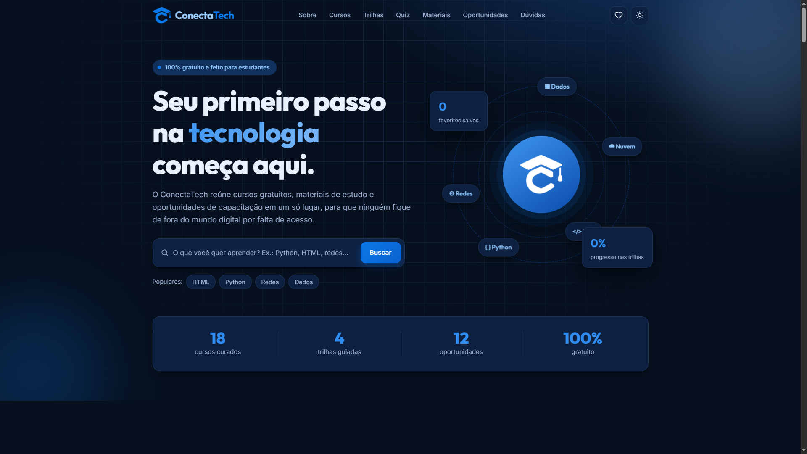

<h1 align="center">ConectaTech</h1>

<p align="center">
  <strong>Tecnologia acessível para todos.</strong><br>
  Plataforma gratuita que reúne cursos, materiais de estudo e oportunidades de capacitação em tecnologia para estudantes de baixa renda.
</p>

<p align="center">
  <a href="https://georgederick.github.io/Conecta-Tech/"><strong>Ver demonstração ao vivo</strong></a>
</p>

<p align="center">
  
  
  
  
  
</p>

<p align="center"></p>

## Sobre o projeto

Muita gente quer entrar na área de tecnologia, mas não sabe por onde começar ou não tem como pagar. O ConectaTech organiza o que já existe de bom e gratuito e apresenta de forma simples, em um só lugar.

O projeto não hospeda cursos próprios. Ele reúne e organiza conteúdos de outras plataformas, por área e nível, para facilitar a escolha de quem está começando.

## Funcionalidades

- **Catálogo de cursos gratuitos** com busca por texto e filtros por área, nível (iniciante ou intermediário) e idioma (português ou inglês). Também é possível ordenar por destaque, ordem alfabética ou nível.
- **Favoritos:** salve cursos para montar seu plano de estudos, consulte a lista em um painel próprio e limpe tudo quando quiser.
- **Trilhas de aprendizado:** caminhos passo a passo por área, em que você marca cada etapa concluída e acompanha o progresso. Os dados ficam salvos no próprio navegador.
- **Quiz "Descubra seu perfil":** quatro perguntas que indicam a trilha mais adequada.
- **Biblioteca de materiais:** documentações, plataformas de prática e referências confiáveis.
- **Oportunidades:** programas, benefícios para estudantes, comunidades e eventos.
- **Perguntas frequentes** e formulário para receber novidades.
- **Navegação por âncoras** entre as seções: Sobre, Cursos, Trilhas, Quiz, Materiais, Oportunidades e Dúvidas.
- **Acessibilidade:** link para pular direto ao conteúdo principal.

## Tecnologias

- HTML, CSS e JavaScript puros, sem frameworks
- Armazenamento local do navegador para favoritos e progresso nas trilhas
- Hospedagem estática no GitHub Pages

## Como executar localmente

Não há dependências nem etapa de build.

```bash
git clone https://github.com/georgederick/Conecta-Tech.git
cd Conecta-Tech
```

Abra o arquivo `index.html` no navegador. Se preferir um servidor local:

```bash
python3 -m http.server 8000
```

Depois acesse `http://localhost:8000`.

## Como publicar no GitHub Pages

1. Envie o repositório para o GitHub.
2. Em **Settings**, abra **Pages**.
3. Em **Branch**, escolha `main` e a pasta `/ (root)`, e salve.
4. O site fica disponível em `https://georgederick.github.io/Conecta-Tech/`.


## Aviso

Projeto acadêmico sem fins lucrativos. Os cursos e materiais pertencem às respectivas plataformas, e as informações sobre prazos e requisitos de oportunidades devem ser confirmadas nos sites oficiais.

## Autor

**Desenvolvido por georgederick**

- GitHub: [github.com/georgederick](https://github.com/georgederick)
- LinkedIn: [linkedin.com/in/georgederick](https://www.linkedin.com/in/georgederick/)
